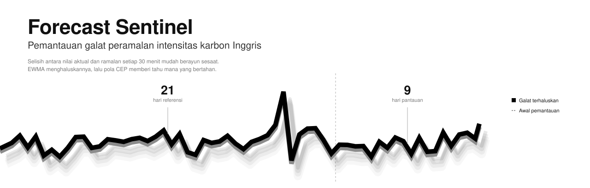
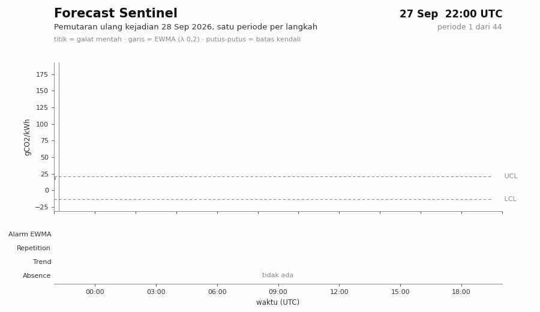
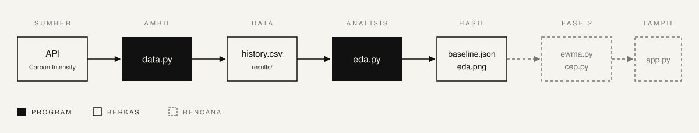

<p align="center">
  
</p>

# Forecast Sentinel

Sistem pemantauan *near-real-time* yang mendeteksi kapan ramalan intensitas karbon listrik Inggris mulai meleset secara berkelanjutan, bukan sekadar melonjak sesaat. Galat ramalan dihaluskan dengan **EWMA**, lalu pola yang bertahan dikenali dengan **Complex Event Processing (CEP)**.

<p align="center">
  
</p>

## Sekilas

| | |
|---|---|
| **Data** | Ramalan (*forecast*) dan nilai aktual (*actual*) intensitas karbon dalam gCO2/kWh, tiap 30 menit, dari [Carbon Intensity API](https://api.carbonintensity.org.uk) |
| **Pertanyaan** | Kapan galat ramalan (`actual − forecast`) menyimpang dan bertahan menyimpang? |
| **Metode** | EWMA dengan batas kendali yang dikalibrasi dari data, lalu pola Repetition, Trend, dan Absence |
| **Hasil** | Sekitar 0,7 kejadian alarm per hari, dan sekitar 0,3 per hari di antaranya bertahan menjadi pola Repetition |
| **Status** | Fase 1 dan 2 selesai (data, baseline, EWMA, CEP). Dashboard (Fase 3) berikutnya |

## Latar belakang

Intensitas karbon listrik (gCO2/kWh) menyatakan banyaknya emisi CO2 per kWh listrik, dan nilainya berubah setiap setengah jam mengikuti bauran pembangkit. Ramalannya dapat dipakai untuk menggeser konsumsi listrik ke waktu yang lebih rendah karbon.

Namun ramalan bisa meleset. Jika melesetnya membesar dan bertahan, keputusan yang bergantung pada ramalan itu ikut keliru. Karena itu kualitas ramalan sendiri perlu dipantau, dan pemantauannya harus mengikuti data yang datang terus-menerus: tiap periode baru diproses begitu tiba, tanpa menunggu seluruh data terkumpul.

## Masalah

| Masalah | Akibat jika diabaikan |
|---|---|
| **Galat berisik.** Selisih `actual − forecast` sering melonjak sesaat tanpa berarti ramalannya rusak | Alarm pada setiap lonjakan menghasilkan banyak alarm palsu |
| **Galat berautokorelasi.** Galat tinggi cenderung diikuti galat tinggi (korelasi lag-1 ≈ 0,5) | Batas kendali buku teks (L = 3) terlalu sempit: sekitar 4–6% periode normal ikut beralarm, bukan 0,27% |
| **Galat berekor tebal.** Nilai ekstrem menggelembungkan simpangan baku biasa | Batas menjadi tidak stabil |
| **Data berupa aliran** | Metode harus memproses satu periode sekali dengan memori kecil |

Pertanyaan intinya: bagaimana membedakan penyimpangan yang **bertahan** dari lonjakan **sesaat**, dengan tingkat alarm palsu yang terkendali?

## Tujuan

1. Membangun detektor streaming berbasis EWMA dengan batas kendali yang **dikalibrasi dari data**, bukan diambil dari tabel normal.
2. Mengenali pola dari rangkaian alarm dengan CEP.
3. Memilih pengaturan berdasarkan bukti: tingkat alarm palsu dan kecepatan deteksi.
4. Menyajikan hasilnya dalam dashboard *near-real-time*.

## Metode

**EWMA** (*Exponentially Weighted Moving Average*) adalah rata-rata galat yang memberi bobot terbesar pada galat terbaru:

`z_t = λ · r_t + (1 − λ) · z_(t−1)`, dengan `r_t` galat yang sudah dibakukan oleh baseline dan λ = 0,2.

Satu lonjakan hanya menggeser `z` sebesar λ kali besarnya, sehingga alarm baru menyala bila galat tinggi **bertahan** beberapa periode. Alarm menyala ketika `z` keluar dari batas kendali atas (UCL) atau bawah (LCL).

**Baseline** adalah rata-rata dan sebaran galat dari 21 hari pertama (*referensi*), dianggap kondisi normal. Sebarannya memakai `robust_std` (1,4826 × MAD) agar tidak ikut membesar oleh nilai ekstrem. Hari-hari sesudahnya adalah data *pantauan*.

**Kalibrasi batas.** Lebar batas (L) dicari dari data referensi sehingga sekitar α dari periode normal beralarm. Karena galat berautokorelasi, L yang diperoleh jauh di atas 3 (pada data 10 Sep – 10 Okt 2026: L ≈ 4,3 untuk α = 5%).

**CEP** memproses periode satu per satu sambil mengingat keadaan sebelumnya untuk mengenali pola:

| Pola | Aturan | Pengaturan |
|---|---|---|
| **Repetition** | Alarm EWMA muncul berturut-turut | 3 periode (1,5 jam) |
| **Trend** | Rata-rata galat bergulir naik (atau turun) terus dan sudah jauh dari normal | Jendela 4 periode, 3 langkah, jarak ≥ 1,5σ0 |
| **Absence** | Tidak ada data baru | Lebih dari 90 menit |

σ0 adalah `robust_std` dari baseline.

## Alur kerja

<p align="center">
  
</p>

1. **Ambil data.** `data.py` mengambil forecast dan actual dari API, menyimpannya sebagai cache (`results/history.csv`), dan menghitung galat. Data juga bisa diputar ulang satu periode demi satu periode untuk meniru aliran.
2. **Tetapkan baseline.** `eda.py` membagi data menjadi 21 hari referensi dan sisanya pantauan, lalu menghitung baseline beserta diagnostiknya, seperti autokorelasi dan pola per jam (`results/baseline.json`, `results/eda.png`).
3. **Pantau dengan EWMA.** `ewma.py` mengkalibrasi lebar batas dari referensi, lalu menilai tiap periode baru. Modul ini juga membandingkan berbagai pengaturan (`results/ewma_grid.csv`).
4. **Kenali pola.** `cep.py` membaca rangkaian alarm dan menandai Repetition, Trend, dan Absence (`results/cep_summary.csv`).
5. **Tampilkan.** `app.py` (Fase 3, berikutnya) memutar ulang data sebagai aliran dan menandai alarm di dashboard.

Tahap EWMA dan CEP memproses satu periode sekali, sehingga hasilnya sama persis baik data diproses sekaligus (batch) maupun satu per satu (stream).

## Hasil

### Contoh pemutaran ulang

GIF di atas memutar ulang salah satu kejadian yang bertahan. Pada contoh ini ramalan anjlok sementara nilai aktual bergerak mulus, sehingga galat mentah (titik abu-abu) melonjak dan bertahan tinggi. EWMA (garis hitam) naik lebih pelan dan keluar dari batas kendali beberapa periode setelah galat mulai naik. Pola **Repetition** terkonfirmasi satu jam kemudian, saat alarm sudah tiga periode berturut-turut. Panel bawah menunjukkan kapan tiap pola aktif.

### Seluruh periode

<p align="center">
  
</p>

Sebagian besar alarm hanya berlangsung satu sampai tiga periode, yaitu lonjakan sesaat yang memang ingin disaring. Hanya sedikit yang bertahan menjadi Repetition.

### Jumlah kejadian per pola

Data 11 Sep – 11 Okt 2026. Satu kejadian adalah satu rangkaian periode berturut-turut yang memenuhi pola. Format: jumlah (per hari).

| Pola | Referensi (21 hari) | Pantauan (9 hari) |
|---|---|---|
| Alarm EWMA | 15 (0,71) | 6 (0,67) |
| Repetition | 6 (0,29) | 3 (0,33) |
| Trend naik | 18 (0,86) | 6 (0,67) |
| Trend turun | 15 (0,71) | 8 (0,89) |
| Absence | 0 | 0 |

Laju kejadian di referensi dan pantauan hampir sama, tanda bahwa batas yang dihitung dari referensi juga berlaku pada data baru. Angka bergeser sedikit tiap hari karena jendela 30 hari mengikuti data terbaru.

<details>
<summary><b>Mengapa λ = 0,2 dan α = 5%?</b></summary>

<br>

Grid 3 (λ) × 3 (α) × 2 (baseline global atau per jam) dibandingkan pada data 10 Sep – 10 Okt 2026. Tiap pengaturan dinilai dari tingkat alarm di data pantauan dan kecepatannya mendeteksi pergeseran buatan sebesar +1σ0 dan +2σ0.

| Pengaturan | L | Alarm pantauan | Deteksi +1σ0 | Deteksi +2σ0 |
|---|---|---|---|---|
| **Global, λ 0,2, α 5% (dipilih)** | 4,33 | 4,2% (target 5%) | 20 periode (10 jam) | 5 periode (2,5 jam) |
| Global, λ 0,3, α 5% | 4,04 | 6,9% | 19 periode | 4 periode |
| Global, λ 0,3, α 2% | 5,54 | 1,6% | 24 periode | 18 periode (9 jam) |

- α 5% mendeteksi jauh lebih cepat daripada 2%, dengan sekitar 0,7 kejadian alarm per hari. L pada α 2% juga lebih peka terhadap beberapa kejadian ekstrem di referensi.
- Di antara tiga nilai λ pada α 5%, λ 0,2 paling dekat dengan target pada data pantauan.
- Baseline per jam tidak lebih baik secara konsisten dan hanya punya 42 galat per jam, jadi dipakai baseline global.
- Kejadian ekstrem di referensi tampak seperti kegagalan peramalan sungguhan, bukan gangguan data, sehingga referensi dipakai utuh.

Hasil lengkap ada di `results/ewma_grid.csv`.

</details>

## Cara menjalankan

```bash
pip install -r requirements.txt

python data.py --days 30   # ambil data dan cetak laporan kualitas
python eda.py              # baseline dan grafik eksplorasi
python ewma.py             # bandingkan pengaturan EWMA
python cep.py              # hitung kejadian per pola
python visual.py           # buat GIF dan gambar hasil untuk README
```

Semua skrip punya opsi `--mode`: `auto` (coba API, pakai cache bila gagal), `live` (wajib API), dan `csv` (hanya cache, tanpa internet). Jendela 30 hari mengikuti data terbaru, jadi pakai `--mode csv` untuk mengulang hasil dari cache yang sama.

## Struktur repositori

```
.
├── data.py          # pengambilan data, cache, dan pemutaran ulang
├── eda.py           # referensi, baseline, dan eksplorasi
├── ewma.py          # detektor EWMA dan kalibrasi batas
├── cep.py           # pola Repetition, Trend, Absence
├── visual.py     # pembuat GIF dan gambar hasil untuk README
├── assets/            # banner, diagram alur, GIF, dan gambar hasil
├── results/         # keluaran: baseline, grafik, tabel perbandingan, ringkasan pola
├── requirements.txt
└── README.md
```