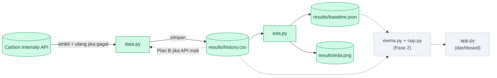
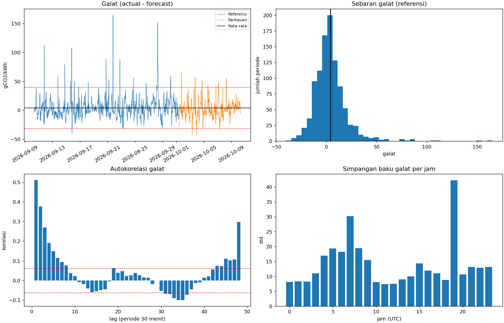
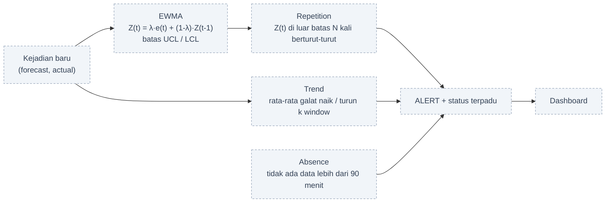

<p align="center">
  
</p>

<p align="center">
  
  
  
  
  
</p>

<p align="center"><b>Ramalan bisa meleset tanpa ada yang sadar. Sentinel ini yang menyadarinya.</b></p>

## Tentang proyek

Intensitas karbon listrik Britania Raya (gCO2/kWh) diramalkan setiap 30 menit. Proyek ini membandingkan ramalan (*forecast*) dengan kenyataan (*actual*), menghitung galatnya, lalu memantau galat itu terus-menerus untuk mendeteksi ramalan yang mulai bias, memburuk, atau data yang berhenti masuk.

Dua metode inti: **EWMA** (kendali statistik atas galat) dan **Complex Event Processing / CEP** (pola kejadian berurutan: *Repetition*, *Trend*, *Absence*). Proyek mata kuliah Analisis Big Data.

## Sekilas

| **1.440** | **0** | **+4,1** | **0,51** |
|:---:|:---:|:---:|:---:|
| periode data (30 hari) | periode hilang | rata-rata galat (gCO2/kWh) | autokorelasi galat lag-1 |

<sub>Cuplikan data 10 September sampai 10 Oktober 2026. Angka berubah setiap program dijalankan karena jendela datanya bergeser.</sub>

## Arsitektur



Hijau: sudah selesai. Abu-abu putus-putus: direncanakan.

## Temuan awal (EDA)

<p align="center">
  
</p>

| Temuan | Bukti | Dampak pada desain |
|---|---|---|
| Galat bergerombol | Autokorelasi lag-1 = 0,51 (batas kebetulan ±0,06) | Batas kendali EWMA dikalibrasi dari data, tidak hanya memakai rumus teoretis |
| Besar galat bergantung jam | Simpangan baku per jam berkisar 7,4 sampai 42,3 gCO2/kWh | Baseline per jam dipertimbangkan |
| Ada galat ekstrem | Maksimum 165, sedangkan persentil ke-95 hanya 30 | Simpangan baku robust (11,9) dipakai di samping simpangan baku biasa (17,4) |

## Rencana Fase 2



- [x] Pengambilan data dari API, parsing, dan perhitungan galat
- [x] Cache CSV dan Plan B saat API tidak tersedia
- [x] Simulator stream dari data historis
- [x] EDA dan baseline statistik
- [ ] Engine EWMA dengan batas kendali terkalibrasi
- [ ] Engine CEP: Repetition, Trend, Absence
- [ ] Dashboard `app.py`

## Mulai cepat

Membutuhkan Python 3.10 atau lebih baru.

```bash
git clone https://github.com/imadepandu/forecast-sentinel.git
cd forecast-sentinel

python -m venv .venv
.venv\Scripts\activate          # Windows
source .venv/bin/activate       # macOS / Linux
pip install -r requirements.txt

python data.py --days 30        # ambil data, simpan ke results/history.csv
python eda.py                   # baseline, autokorelasi, profil per jam
```

## Struktur proyek

```
.
├── assets/banner.svg     gambar untuk README
├── data.py               ambil data, galat, cache CSV, simulator stream
├── eda.py                baseline, autokorelasi, profil per jam
├── results/              hasil: history.csv, baseline.json, eda.png
├── requirements.txt
└── README.md
```

## Skema data

`results/history.csv`, satu baris per periode 30 menit:

| Kolom | Keterangan |
|---|---|
| `timestamp` | Awal periode (UTC) |
| `period_end` | Akhir periode (UTC) |
| `forecast` | Ramalan intensitas karbon (gCO2/kWh) |
| `actual` | Kenyataan (gCO2/kWh); kosong jika belum tersedia |
| `error` | `actual - forecast`; positif berarti ramalan terlalu rendah |

<details>
<summary><b>Opsi perintah</b></summary>

| Opsi | Keterangan |
|---|---|
| `--days` | Jumlah hari data (default 30) |
| `--mode` | `auto` (API, jatuh ke file jika gagal), `live` (API wajib), `csv` (hanya file tersimpan) |
| `--path` | Lokasi file riwayat (default `results/history.csv`) |
| `--reference-days` | Khusus `eda.py`: hari awal yang dijadikan referensi (default 21) |

</details>

<details>
<summary><b>Metode Fase 1</b></summary>

- **Referensi dan pantauan**: `--reference-days` hari pertama menjadi *referensi* (kondisi normal), sisanya menjadi *pantauan*. Pembagian berurutan waktu, bukan acak.
- **Baseline** (`results/baseline.json`): rata-rata, simpangan baku, median, dan simpangan baku robust (1,4826 × MAD) dari galat periode referensi. Dihitung sekali dan tetap.
- **Autokorelasi**: korelasi galat dengan galat `lag` periode sebelumnya (1 periode = 30 menit). Nilai di luar ±1,96/√n menunjukkan keterkaitan yang nyata.
- **Profil per jam**: rata-rata dan simpangan baku galat untuk tiap jam (UTC).

</details>

## Sumber data

[Carbon Intensity API](https://carbonintensity.org.uk): data per 30 menit, tanpa API key. Berkas di `results/` adalah cuplikan pada tanggal program dijalankan dan dapat dibuat ulang kapan saja.